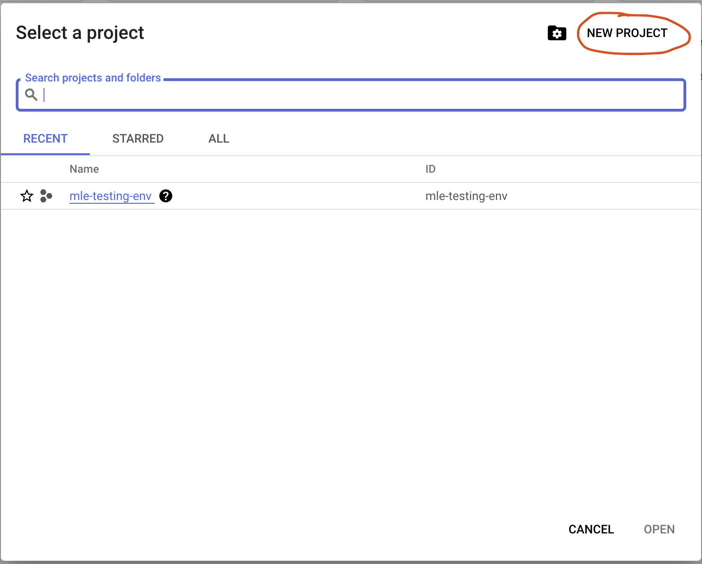
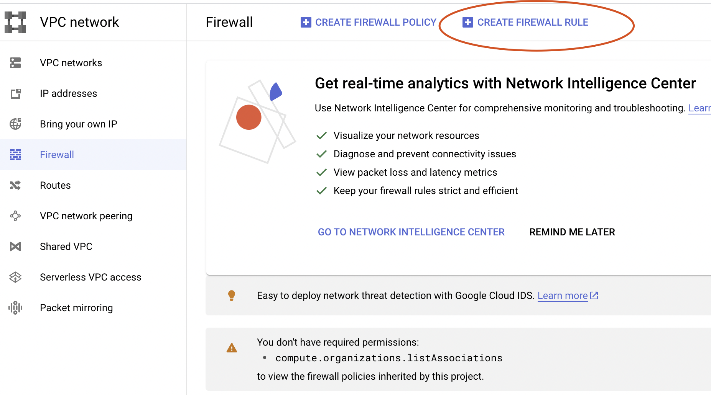
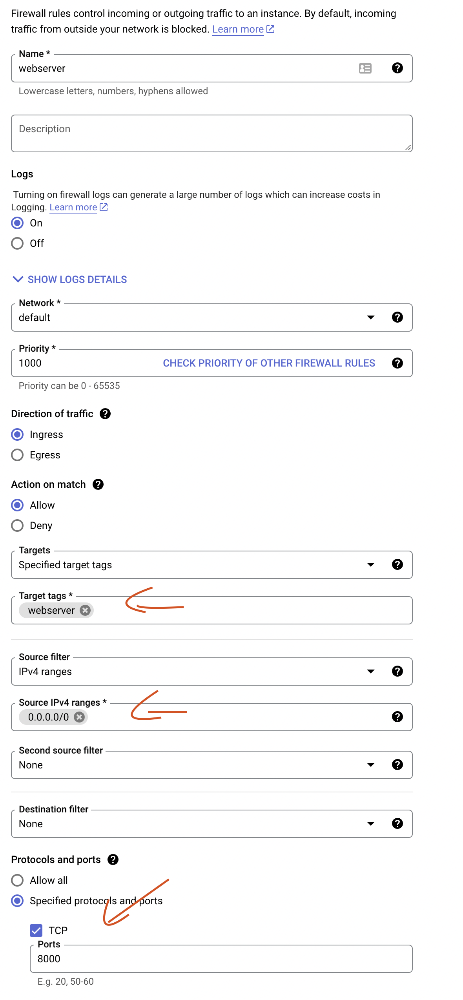
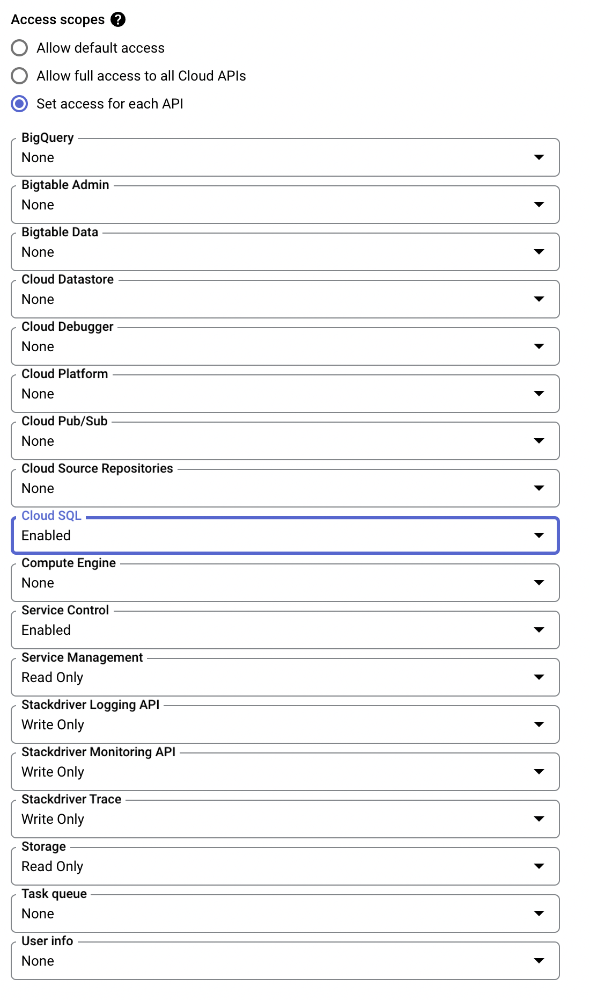
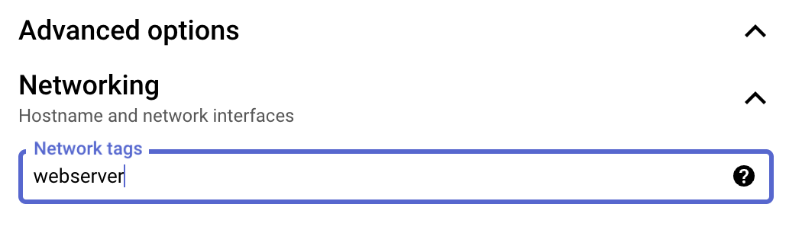

# Google Cloud Platform (GCP) Intro

## What is GCP?
You should all have at least some idea what the GCP is. If you don't, here's a quick overview:
- Google Cloud Platform is a cloud computing service that offers computing power, database storage, content delivery and other functionality to help businesses scale and grow.
- GCP is a cloud computing service that runs on the same infrastructure that Google uses internally for its end-user products, such as Google Search and YouTube.
- GCP offers developers and IT professionals the ability to build, test, deploy, and manage applications on Google's highly-scalable and reliable infrastructure.
- GCP provides a set of modular cloud-based services that allow you to create anything from simple websites to complex applications.

## Why use GCP?

There are three big provider of cloud computing services: Amazon Web Services (AWS), Microsoft Azure, and Google Cloud Platform (GCP). Each of these providers has its own set of advantages and disadvantages. 

GCP offers a easy entry point for developers and IT professionals who are new to cloud computing. And offers the highest amount of free credits of the three providers, so you can get started and try out things without spending a dime.

## Getting Started

### Create a GCP Account

To get started, you'll need to create a GCP account. You can do this by going to [https://cloud.google.com/](https://cloud.google.com/) and clicking the "Try for free" button. You'll be prompted to create a new account.

### Install the GCP SDK CLI

The GCP SDK is a set of tools that you can use to manage resources and applications hosted on GCP. You can install the GCP SDK on your local machine, or you can use the GCP console.

To install the GCP SDK on your local machine, go to [https://cloud.google.com/cli](https://cloud.google.com/cli) and follow the instructions for your operating system.

For macOS, you can install the GCP SDK by running the following command in your terminal:

```bash
brew install --cask google-cloud-sdk
```

### Authenticate

Once you've installed the GCP SDK, you'll need to authenticate. You can do this by running the following command in your terminal:

```bash
gcloud auth login
```

This will open a browser window where you can log in to your GCP account. Once you've logged in, you'll be prompted to enter a verification code. Copy the verification code from the browser window and paste it into your terminal. You should now be authenticated.

### Create a Project

Once you've created your account, you'll be taken to the GCP console. The first thing you'll need to do is create a project. A project is a container for all of the resources you create on GCP. You can create multiple projects, and you can have multiple resources in each project.

To create a project, click the "Select a project" dropdown in the top left corner of the console, and then click "New Project". Give your project a name, and then click "Create".



### Billing

Once you've created your project, you can go to the billing section via the "Select a project" dropdown in the top left corner of the console. You'll need to enable billing for your project in order to use GCP. You can do this by clicking "Enable billing". But don't worry, you'll get $300 in free credits to use for 90 days.

In the billing section, you can also see how much you've spent on GCP. You can also set up billing alerts to be notified when you've spent a certain amount of money.

You can also use the [GCP Pricing Calculator](https://cloud.google.com/products/calculator) to estimate how much you'll spend on GCP. This is useful if you want to know how much you'll spend on a certain project.

### Set the Project

Now that you've authenticated, you'll need to set the project that you want to use. You can do this by running the following command in your terminal:

```bash
gcloud config set project <project-id>
```

Replace `<project-id>` with the ID of the project that you want to use. You can find the ID of your project in the GCP console.


### Firewall Rules

Now we need to create a firewall rule to allow traffic to the port 9696. To create a firewall rule, click the "Navigation menu" button in the top left corner of the console, and then click "VPC network". Then click "Firewall" in the left sidebar.





We'll be creating a firewall rule with the following settings:
1. In GCP go to VPC network
2. Go to Firewall rules
3. Click on Create Firewall Rule
4. Give it a name: webserver
5. Set logging to On
6. Network: default
7. Priority: 1000
8. Direction of traffic: Ingress
9. Action on match: Allow
10. Target-Tag: webserver
11. Source IP ranges: 0.0.0.0/0
12. Protocols and ports: tcp:8000
13. Click on Create



### Create a Virtual Machine

Now that you've created a project and enabled billing, you can create a virtual machine. A virtual machine is a virtual computer that runs on GCP. You can use a virtual machine to run applications and services.

To create a virtual machine, click the "Navigation menu" button in the top left corner of the console, and then click "Compute Engine". Then click "VM instances" in the left sidebar. You probably have to enable the API. And than click "Create Instance".

We'll be creating a virtual machine with the following settings:

- Name: `web-server`
- Region: `europe-west3` 
- Zone: `europe-west3-c`
- Series: `E2`
- Machine type: `e2-small` (for now it is only for testing)


Under Access scopes, we'll select "Set access for each API". And choose Cloud SQL `Enable`.




And under Advanced options -> Networking we set the Network tags: `webserver` 


We can leave the rest of the settings as they are. Click "Create".

### Create a SQL Instance

Now that we've created a virtual machine, we can create a SQL instance. A SQL instance is a virtual machine that runs a SQL database. You can use a SQL instance to store data for your applications and services.

Of course we could also create a SQL Database in an VM but the advantage of a SQL Instance is that it is managed by Google and you don't have to worry about the maintenance of the VM.

To create a SQL instance, click the "Navigation menu" button in the top left corner of the console, and then click "SQL". Then click "Create Instance" in the left sidebar. You probably have to enable the API. And than click "Create Instance". We will create a PostgreSQL instance.

We'll be creating a SQL instance with the following settings:

- Instance ID: `web-server-db`
- Password: Your password (make sure you keep it somewhere this is your db password)
- postgres version: `PostgreSQL 14`
- configuration: `sandbox` (for now it is only for testing)
- Region: `europe-west3` 
- Zone: `europe-west3-c`

We have to customize the instance. Under connections we will choose `Private IP`. We will use the default network, it may happen that you need to enable the networking API if that happens choose the automatically allocated ip range.

### Connect to the Virtual Machine

Now that we've created a virtual machine and a SQL instance, we can connect to the virtual machine. To connect to the virtual machine, click the "Navigation menu" button in the top left corner of the console, and then click "Compute Engine". Then click "VM instances" in the left sidebar. You should see a list of virtual machines. Click the name of the virtual machine that you want to connect to.

You should now see the details of the virtual machine. Click the "SSH" button in the top right corner of the console. This will open a terminal window where you can run commands on the virtual machine. Or you can use the GCP SDK CLI in your local terminal if you click on the arrow next to the "SSH" button and the `View gcloud command`.

### Install PostgreSQL

Now that we've connected to the virtual machine, we can install PostgreSQL. PostgreSQL is an open-source relational database management system. You can use PostgreSQL to store data for your applications and services.

To install PostgreSQL, run the following command in the terminal window:

```bash
sudo apt-get update
sudo apt-get install postgresql 
```

### Connect to the SQL Instance

Now that we've installed PostgreSQL, we can connect to the SQL instance. To connect to the SQL instance, run the following command in the terminal window:

```bash
psql -h <ip-address> -U <username>
```

Replace `<ip-address>` with the private IP address of the SQL instance. You can find the private IP address of the SQL instance in the GCP console. Replace `<username>` with the username of the SQL instance. You can find the username of the SQL instance in the GCP console. 

You'll be prompted to enter a password. Enter the password of the SQL instance. You can find the password of the SQL instance in the GCP console.

Now that we know that the connection works we can create a database and a user for our application.

### Create a Artifact Registry

Now that we've connected to the SQL instance, we can create a Artifact Registry. A Artifact Registry is a private Docker registry. You can use a Artifact Registry to store Docker images for your applications and services.

To create a Artifact Registry, click the "Navigation menu" button in the top left corner of the console, and then click "Artifact Registry". Then click `Enable`afterward you can click on the `+` to create repository.

We'll be creating a Artifact Registry with the following settings:

- name: `docker-registry`
- format: `Docker`
- mode: `standard`
- region: `europe-west3` 

We can leave the rest of the settings as they are. Click "Create".

### Install Docker in the Virtual Machine

Now that we've created a Artifact Registry, we can install Docker in the virtual machine. 

Opening a terminal for a Compute Engine VM instance:
1. In the Cloud Console, go to the VM instances page.
2. Click SSH in the row of the instance that you want to connect to.

To install Docker, run the following command in the terminal window of your VM:

```bash
sudo apt-get update
sudo apt-get install docker.io
```

### Push the Docker Image to the Artifact Registry

To be able to push the Docker image to the Artifact Registry, we have to authenticate with the Artifact Registry. To authenticate with the Artifact Registry, run the following command in the terminal window:

```bash
gcloud auth configure-docker \
    europe-west3-docker.pkg.dev
```

Replace `europe-west3-docker.pkg.dev` with the location of the Artifact Registry you chose. 

Now we can push our Docker of the web server from yesterday to the Artifact Registry. To push the Docker image to the Artifact Registry, run the following command in the terminal window:

```bash
docker buildx build --no-cache --platform linux/amd64 --push -t europe-west3-docker.pkg.dev/<project-id>/<name of your registry>/web-server-repo:latest  .
```

Replace `<project-id>` with the ID of the project that you want to use. Replace `europe-west3-docker.pkg.dev` with the location of the Artifact Registry you chose.
Replace `<name of your registry>` with the name of your registry. If you followed the steps above it should be `docker-registry`.

`--no-cache` will make sure that the Docker image is build from scratch.

`buildx` is a Docker CLI plugin that allows you to build Docker images for multiple platforms. You can find more information about `buildx` [here](https://docs.docker.com/buildx/working-with-buildx/). It can make problems if you simply use `docker build` if you build images on macOS or Windows and deploy the images on Linux. `--platform linux/amd64` will make sure that the Docker image is build for the Linux platform. 

`--push` will push the image to the registry.

`-t` will tag the image.

`europe-west3-docker.pkg.dev/<project-id>/web-server-repo:latest` is the location of the image in the registry.

`.` is the location of the Dockerfile (so make sure you are in the right directory).

### Pull the Docker Image from the Artifact Registry

Now that we've pushed the Docker image to the Artifact Registry, we can pull the Docker image from the Artifact Registry. To pull the Docker image from the Artifact Registry, run the following command in the terminal window of the VM:

```bash
docker pull europe-west3-docker.pkg.dev/<project-id>/docker-registry/web-server-repo:latest
```

Replace `<project-id>` with the ID of the project that you want to use. 

If you get a permission error check with `ls -a` if a `.docker` folder exists. If not run the following command in the VM terminal window:

```bash
gcloud auth configure-docker \
    europe-west3-docker.pkg.dev
```

Check if the folder exists now with `ls -a` and try to pull the image again with:


```bash
docker --config /home/<your_user_name>/.docker pull europe-west3-docker.pkg.dev/<project-id>/docker-registry/web-server-repo:latest
```

Replace `<project-id>` with the ID of the project that you want to use. And `<your_user_name>` with the name of your user.

### Run the Docker Image

Now that we've pulled the Docker image from the Artifact Registry, we can run the Docker image. To run the Docker image, run the following command in the terminal window of the VM:

```bash
docker run -d --name fastapi -e DB_CONN='postgresql://postgres:<password>@<db-ip-address>:5432/postgres' -p 8000:8000 europe-west3-docker.pkg.dev/<project-id>/docker-registry/web-server-repo:latest
```

Replace `<password>` with the password you set for SQL instance. 
Replace `<db-ip-address>` with the private IP address of the SQL instance. 
Replace `<project-id>` with the ID of the project that you want to use.

### Alternative

During the set up of the VM there is an option to choose a container image from the artifcat registry. You can choose the image you just pushed and it will automatically pull the image and run it.

So if you are sure that the setup and connections to databases work you can skip the steps above and just choose the image from the artifact registry.

### Connect to the Web Server

Now that we've run the Docker image, we can connect to the web server. To connect to the web server, open a browser and go to `http://<ip-address>:8000`. Replace `<ip-address>` with the public IP address of the virtual machine. You can find the public IP address of the virtual machine in the GCP console.

# IMPORTANT

After you are done: **STOP EVERY RUNNING SERVICE!** 
So stop the VM and the SQL Database. Running services cost money/credits!

